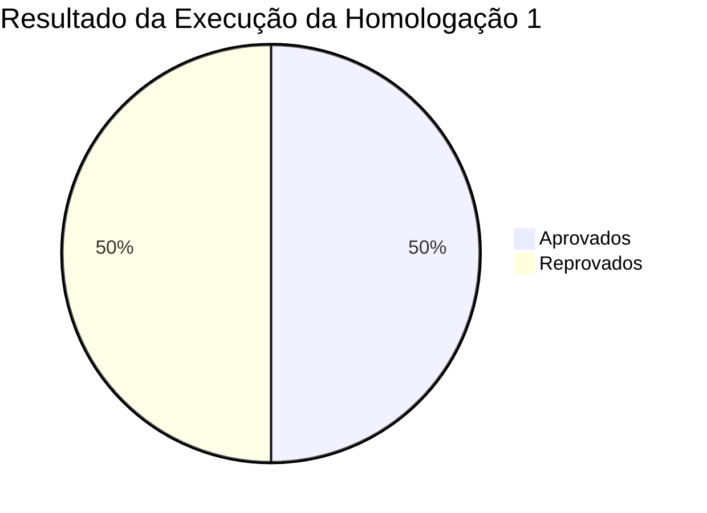

# Relatório Final de Homologação 1 — Sistema ISRP

**Documento:** `docs/homologacao-01-relatorio-final.md`  
**Projeto:** ISRP — Sistema Integrado de Solicitações e Processos (SENAI Serviços Digitais — Projeto Acadêmico Fictício)  
**Ciclo de Teste:** Homologação 1 (Primeira Homologação com Defeitos Controlados)  
**Data da Homologação:** 13 de Outubro de 2026  
**Responsável Técnico:** Analista de Qualidade de Software (QA)  
**Branch Auditada:** `homologacao-com-defeitos`  
**Versão Sob Homologação:** `v1.0.0-homologacao-com-defeitos` (Commit Git: `35fefd8`)  
**Status da Versão:** **REPROVADA PARA PRODUÇÃO (BLOQUEADA)**

---

## 1. Sumário Executivo

Este relatório apresenta o diagnóstico técnico e a consolidação dos resultados obtidos durante a **primeira homologação formal do Sistema ISRP**. O sistema foi submetido a uma bateria de testes funcionais, de integração entre frontend e API Express, e de persistência relacional no banco de dados MySQL 8.

Foram executados **10 casos de teste formais** que abrangeram desde autenticação, autorização por papéis (RBAC) e healthcheck até os fluxos operacionais críticos de abertura de chamados, controle de status, histórico e indicadores de gestão.

Dos 10 testes executados, **5 foram APROVADOS (50%)** e **5 foram REPROVADOS (50%)**. As reprovações decorrem de defeitos controlados nas camadas de validação de dados, sincronização de estado na interface do usuário, tratamento de exceções e métricas de painel executivo.

Com base na presença de defeitos de **Severidade Alta** que comprometem a integridade da base de dados e a precisão das tomadas de decisão gerenciais, a equipe de QA emite o parecer conclusivo de **REPROVAÇÃO DA VERSÃO 1.0.0**, recomendando o encaminhamento dos apontamentos para o time de desenvolvimento antes de qualquer implantação ou avanço para a fase de Hypercare.

---

## 2. Escopo da Homologação

A homologação cobriu os principais requisitos funcionais e não-funcionais do sistema:

1. **Gestão de Acesso e Autenticação (RF-03, RF-04):** Validação de credenciais, geração de cookies seguros de sessão (`isrp.sid`), autorização RBAC de perfis `admin` e `usuario`, e bloqueio de rotas administrativas.
2. **Abertura de Solicitações (RF-01, RF-02):** Formulário de registro de novos chamados, consistência de campos obrigatórios, regras de tamanho de texto e vinculação com catálogo de serviços.
3. **Gestão e Atendimento de Chamados (RF-05, RF-06):** Interface do operador no painel admin, alteração de status (`Aberta` → `Em atendimento` → `Resolvida` → `Encerrada`), gravação de comentários e auditoria de histórico.
4. **Painel de Indicadores e SLA (RF-07):** Consolidação dos cartões de KPI (Total de Chamados, Chamados Abertos Hoje, Pendentes e Tempo Médio de Resolução).
5. **Consultas e Filtros Dinâmicos (RF-08):** Busca textual por protocolo/título e filtragem por status na listagem de solicitações.
6. **Infraestrutura e Prontidão Operacional (RF-09):** Monitoramento de integridade e conectividade relacional através do endpoint `/api/health`.

---

## 3. Ambiente e Configuração Técnica

Para garantir a rastreabilidade e evitar a contaminação de bases reais ou produtivas, o teste foi conduzido em ambiente completamente isolado:

- **Servidor Web / API:** Node.js v18+ executando Express 5.3 na porta local `3000`.
- **Banco de Dados de Teste:** Instância MySQL 8.0 rodando localmente (porta 3306), com o esquema isolado e parametrizado **`isrp_homolog_db`**.
- **Preservação da Versão Original:** O código original limpo foi preservado na branch `main` (commit `af86a96`), enquanto a bateria de testes operou na branch `homologacao-com-defeitos`.
- **Variáveis de Ambiente (`.env`):**
  ```properties
  PORT=3000
  NODE_ENV=development
  SESSION_SECRET=isrp-chave-academica-segura-2026
  SESSION_MAX_AGE_MIN=120
  DB_HOST=localhost
  DB_PORT=3306
  DB_USER=root
  DB_NAME=isrp_homolog_db
  ```
- **Contas de Teste Utilizadas:**
  - Administrador: `admin` / `Admin@123` (perfil `admin`)
  - Usuário Comum: `ana.demo` / `Usuario@123` (perfil `usuario`)
  - Usuário Secundário: `bruno.demo` / `Usuario@123` (perfil `usuario`)

---

## 4. Indicadores e Métricas de Execução

| Métrica | Quantidade | Percentual |
| :--- | :---: | :---: |
| **Total de Casos de Teste Planejados** | **10** | **100%** |
| **Casos de Teste Executados** | **10** | **100%** |
| **Casos de Teste APROVADOS** | **5** | **50%** |
| **Casos de Teste REPROVADOS** | **5** | **50%** |
| **Casos de Teste PENDENTES** | **0** | **0%** |
| **Defeitos Controlados Confirmados** | **5** | — |



---

## 5. Relação dos Defeitos Encontrados

| ID Defeito | Título Resumido | Severidade | Prioridade | Teste Reprovado |
| :--- | :--- | :---: | :---: | :---: |
| **[DEF-01](file:///c:/Users/casab/Downloads/Mateus/GestaoFacil/ISRP/docs/homologacao-01-defeitos.md#def-01)** | Validação incompleta de campos obrigatórios no cadastro de solicitações | **Alta** | Alta | `HOM-001` |
| **[DEF-02](file:///c:/Users/casab/Downloads/Mateus/GestaoFacil/ISRP/docs/homologacao-01-defeitos.md#def-02)** | Falha na atualização visual do status após resposta válida da API | **Média** | Alta | `HOM-003` |
| **[DEF-03](file:///c:/Users/casab/Downloads/Mateus/GestaoFacil/ISRP/docs/homologacao-01-defeitos.md#def-03)** | Mensagem de erro inadequada quando a API retorna falha (`[object Object]`) | **Média** | Média | `HOM-004` |
| **[DEF-04](file:///c:/Users/casab/Downloads/Mateus/GestaoFacil/ISRP/docs/homologacao-01-defeitos.md#def-04)** | Histórico de alterações não aparece imediatamente após alteração de status | **Média** | Média | `HOM-005` |
| **[DEF-05](file:///c:/Users/casab/Downloads/Mateus/GestaoFacil/ISRP/docs/homologacao-01-defeitos.md#def-05)** | Indicador do painel administrativo apresenta total de chamados pendentes incorreto | **Alta** | Alta | `HOM-006` |

---

## 6. Registro de Evidências Técnicas

Todas as evidências registradas foram coletadas diretamente a partir da execução do servidor Node.js, das rotas da API REST e de consultas de auditoria no MySQL 8 em `isrp_homolog_db`.

### 6.1. Evidência do Defeito DEF-01 (Teste `HOM-001`)
- **Requisição HTTP Enviada:**
  ```http
  POST /api/solicitacoes HTTP/1.1
  Host: localhost:3000
  Content-Type: application/json
  Cookie: isrp.sid=s%3A...

  {
    "titulo": "Problema na inicialização da máquina",
    "descricao": "",
    "categoria": "Suporte",
    "prioridade": "Média"
  }
  ```
- **Resposta HTTP Obtida (Anomalia):**
  ```http
  HTTP/1.1 201 Created
  Content-Type: application/json; charset=utf-8

  {
    "mensagem": "Solicitação ISRP-2026-00007 registrada com sucesso.",
    "solicitacao": {
      "id": 7,
      "protocolo": "ISRP-2026-00007",
      "titulo": "Problema na inicialização da máquina",
      "descricao": "",
      "categoria": "Suporte",
      "prioridade": "Média",
      "status": "Aberta"
    }
  }
  ```
- **Auditoria no Banco de Dados MySQL:**
  ```sql
  SELECT id, protocolo, titulo, LENGTH(descricao) AS len_desc, status 
  FROM isrp_homolog_db.solicitacoes 
  WHERE id = 7;
  ```
  *Resultado:* Registro persistido com `len_desc = 0` e `descricao = ""`.
- **Log do Servidor:**
  `[2026-10-13T18:28:19.850Z] POST /api/solicitacoes -> 201 (15 ms)`

---

### 6.2. Evidência do Defeito DEF-02 e DEF-04 (Testes `HOM-003` e `HOM-005`)
- **Requisição HTTP de Atualização:**
  ```http
  PATCH /api/solicitacoes/3/status HTTP/1.1
  Host: localhost:3000
  Content-Type: application/json
  Cookie: isrp.sid=s%3A... (admin)

  {
    "status": "Em atendimento",
    "comentario": "Técnico CST iniciando atendimento."
  }
  ```
- **Resposta HTTP Obtida:**
  ```http
  HTTP/1.1 200 OK
  Content-Type: application/json; charset=utf-8

  {
    "mensagem": "Status alterado para \"Em atendimento\".",
    "solicitacao": {
      "id": 3,
      "protocolo": "ISRP-2026-00003",
      "status": "Em atendimento"
    }
  }
  ```
- **Comportamento no DOM do Navegador:**
  - O modal permaneceu renderizando `<span class="badge status-aberta">Aberta</span>`.
  - A tabela da fila geral em `/admin.html` permaneceu inalterada.
  - A linha do tempo `<ol class="linha-tempo">` manteve os registros antigos sem renderizar o novo evento de auditoria.

---

### 6.3. Evidência do Defeito DEF-03 (Teste `HOM-004`)
- **Requisição HTTP:**
  ```http
  POST /api/solicitacoes HTTP/1.1
  Host: localhost:3000
  Content-Type: application/json

  {
    "titulo": "Oi",
    "descricao": "Descrição detalhada do incidente ocorrido na estação de trabalho.",
    "categoria": "Suporte",
    "prioridade": "Média"
  }
  ```
- **Resposta HTTP Obtida:**
  ```http
  HTTP/1.1 400 Bad Request
  Content-Type: application/json; charset=utf-8

  {
    "erro": "Verifique os campos destacados.",
    "detalhes": {
      "titulo": "O título deve ter entre 5 e 150 caracteres."
    }
  }
  ```
- **String Renderizada no Alerta Visual:**
  ```html
  <div id="mensagem-nova" class="mensagem erro">
    Falha no cadastro: [object Object]
  </div>
  ```

---

### 6.4. Evidência do Defeito DEF-05 (Teste `HOM-006`)
- **Requisição HTTP:**
  ```http
  GET /api/admin/indicadores HTTP/1.1
  Host: localhost:3000
  Cookie: isrp.sid=s%3A... (admin)
  ```
- **Resposta da API (com defeito no campo pendentes):**
  ```json
  {
    "total_solicitacoes": 7,
    "total_usuarios": 3,
    "abertas_hoje": 1,
    "pendentes": 2,
    "sla_vencido": 3,
    "tempo_medio_resolucao_horas": 52.4,
    "por_status": {
      "Aberta": 2,
      "Em atendimento": 2,
      "Resolvida": 2,
      "Encerrada": 1
    }
  }
  ```
- **Conferência Relacional no Banco de Dados:**
  ```sql
  SELECT 
    SUM(status = 'Aberta') AS abertas,
    SUM(status = 'Em atendimento') AS em_atendimento,
    SUM(status IN ('Aberta', 'Em atendimento')) AS pendentes_reais
  FROM isrp_homolog_db.solicitacoes;
  ```
  *Retorno:* `abertas: 2`, `em_atendimento: 2`, `pendentes_reais: 4`.  
  *Divergência apurada:* A API entregou `2` em vez de `4`, omitindo 50% dos chamados pendentes da equipe.

---

### 6.5. Evidência dos Testes Aprovados (Segurança, RBAC e Healthcheck)
- **Login Válido (`HOM-007`):** Resposta `HTTP 200 OK` gerando cookie com flags `HttpOnly; SameSite=Lax`.
- **Bloqueio de Credencial Inválida (`HOM-007`):** Resposta `HTTP 401 Unauthorized` com `{ erro: "Usuário ou senha inválidos." }`, protegendo o sistema contra enumeração de usuários.
- **Proteção RBAC (`HOM-008`):** Usuário comum tentando requisitar `/api/admin/indicadores` recebe `HTTP 403 Forbidden` com `{ erro: "Acesso restrito a administradores." }`.
- **Healthcheck (`HOM-010`):** `GET /api/health` respondeu `HTTP 200 OK` com `status: ok` e `banco: conectado` em tempo de resposta inferior a 10ms.

---

## 7. Análise de Impactos

### 7.1. Impacto Operacional e de Suporte
- O registro de chamados com descrição vazia (**DEF-01**) inviabiliza o fluxo de triagem das equipes CST, INFRA e SISCORP, gerando atrasos em cascata nos atendimentos.
- A omissão de chamados "Em atendimento" no indicador de pendentes (**DEF-05**) compromete a gestão da capacidade operacional, fazendo parecer que a equipe está com baixa demanda quando, na realidade, há diversos tickets em andamento.

### 7.2. Impacto de Experiência do Usuário (UX) e Acessibilidade
- A exibição do texto `[object Object]` (**DEF-03**) fere os padrões de usabilidade e acessibilidade (WCAG), impedindo que pessoas com deficiência ou usuários leigos identifiquem correções necessárias em formulários.
- A falta de atualização imediata do status (**DEF-02**) e do histórico (**DEF-04**) gera desconfiança e induz o usuário e os técnicos ao clique repetitivo e à frustração.

### 7.3. Integridade e Segurança da Informação
- Os mecanismos de autenticação (bcrypt, sessões do servidor e proteção contra ataques de fixação de sessão) e o modelo de autorização por perfis (RBAC) **permaneceram íntegros e seguros**, demonstrando solidez na arquitetura de segurança da informação.

---

## 8. Parecer Conclusivo e Recomendação Formal

### PARECER: REPROVADA PARA PRODUÇÃO (BLOQUEADA)

A versão **`v1.0.0-homologacao-com-defeitos`** do sistema ISRP **NÃO ESTÁ APTA** para liberação em ambiente produtivo ou início da operação assistida (Hypercare).

### Justificativa:
1. **Violação de Critérios de Aceitação:** A existência de 2 defeitos de Severidade Alta (**DEF-01** e **DEF-05**) viola a política de qualidade corporativa, que exige 0 defeitos críticos/altos para aprovação.
2. **Corrupção de Dados e Processos:** O sistema permite a persistência de registros corrompidos/incompletos no banco de dados e produz métricas executivas matematicamente falsas.
3. **Instabilidade de Interface:** A camada de apresentação falha na comunicação de erros e no feedback de ações de alteração de workflow.

---

## 9. Próximos Passos Recomendados

1. **Retorno para Desenvolvimento (Sprint de Correção):**
   - Corrigir os 5 defeitos apontados no documento [docs/homologacao-01-defeitos.md](file:///c:/Users/casab/Downloads/Mateus/GestaoFacil/ISRP/docs/homologacao-01-defeitos.md).
   - Manter a integridade das rotas de autenticação e persistência que foram aprovadas com sucesso.
2. **Execução da Homologação 2 (Ciclo de Re-teste):**
   - Submeter o sistema a um novo ciclo de homologação (`Homologação 2`) executando a bateria de regressão dos 10 casos de teste.
   - Comparar os resultados obtidos nesta Homologação 1 com a versão corrigida para validar a erradicação dos defeitos.
