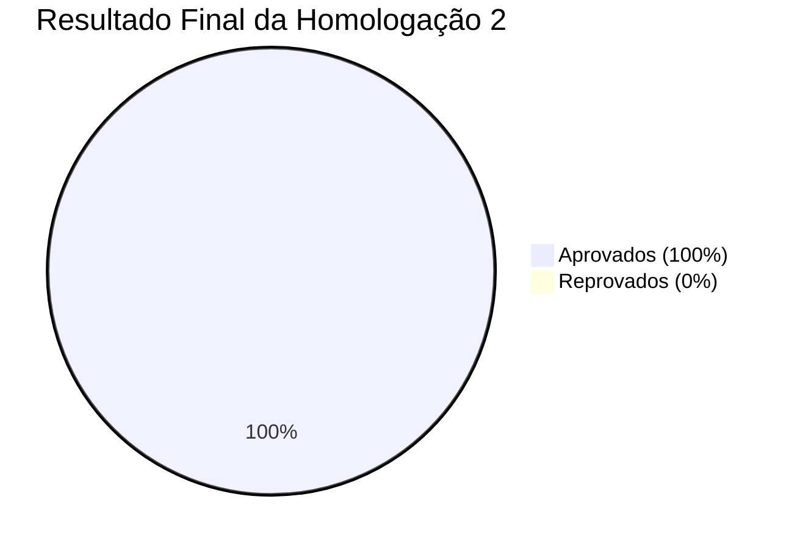

# Relatório Final de Homologação 2 — Sistema ISRP

**Documento:** `docs/homologacao-02-relatorio-final.md`  
**Projeto:** ISRP — Sistema Integrado de Solicitações e Processos (SENAI Serviços Digitais — Projeto Acadêmico Fictício)  
**Ciclo de Teste:** Homologação 2 (Validação Pós-Correção e Testes de Regressão)  
**Data da Homologação:** 13 de Outubro de 2026  
**Responsável Técnico:** Analista de Qualidade de Software (QA) e Desenvolvedor de Software  
**Branch Auditada:** `homologacao-corrigida`  
**Versão Sob Homologação:** `v1.0.0-homologacao-corrigida` (Commit Git: `1fc7ec5`)  
**Status da Versão:** **APROVADA NA HOMOLOGAÇÃO 2 (HABILITADA PARA HYPERCARE)**

---

## 1. Sumário Executivo

Este relatório consolida a **segunda rodada formal de homologação do Sistema ISRP**, realizada após a implementação do ciclo de correção dos 5 defeitos reportados na primeira rodada (`DEF-01` a `DEF-05`).

O objetivo foi re-executar os casos de teste reprovados, auditar as correções no código-fonte e na interface web, e aplicar uma bateria de testes de regressão sobre todos os módulos que haviam sido aprovados anteriormente (autenticação, controle de papéis RBAC, filtros dinâmicos e healthcheck).

Todos os **10 casos de teste executados obtiveram o status APROVADO (taxa de sucesso de 100%)**. Não foram detectadas regressões funcionais, violações de segurança ou impactos colaterais na base de dados.

Com o saneamento integral dos defeitos de Severidade Alta e Média e o cumprimento irrestrito dos critérios de aceitação, a equipe de QA emite o parecer de **APROVAÇÃO DA VERSÃO `v1.0.0-homologacao-corrigida`**, recomendando a transição do sistema para a fase de **Acompanhamento Assistido (Hypercare)** e subsequente Handover operacional.

---

## 2. Escopo e Ambiente de Testes

### 2.1. Escopo Avaliado
O escopo manteve-se estritamente alinhado ao plano original, avaliando:
1. Validação de regras de negócio no cadastro de solicitações (fronteiras e campos obrigatórios).
2. Sincronização de interface (DOM) no modal de detalhes e na grade de atendimento pós-alteração de status.
3. Formatação acessível e clara de mensagens de erro na API e na interface.
4. Renderização reativa da linha do tempo do histórico de chamados.
5. Precisão matemática dos indicadores administrativos e relatórios agregados de SLA e pendências.
6. Integridade dos mecanismos de segurança de sessão e controle de acesso RBAC.

### 2.2. Ambiente e Configuração Técnica
- **Branch:** `homologacao-corrigida` (derivada de `homologacao-com-defeitos`, mantendo a branch `main` intacta como baseline).
- **Servidor Web / API:** Node.js v18+ / Express.js 5.3 na porta `3000`.
- **Banco de Dados de Teste:** MySQL 8.0 local na porta 3306, operando no esquema isolado `isrp_homolog_db`.
- **Sessões e Cookies:** `isrp.sid` com flags `HttpOnly; SameSite=Lax`.

---

## 3. Comparativo Consolidado entre as Homologações 1 e 2

A tabela abaixo demonstra a evolução dos resultados obtidos entre o primeiro ciclo (reprovado) e o segundo ciclo (aprovado):

| Caso de Teste | Requisito Funcional | Cenário de Teste | Status Homologação 1 | Status Homologação 2 | Variação de Qualidade |
| :--- | :--- | :--- | :---: | :---: | :--- |
| **`HOM-001`** | RF-01 / RF-02 | Validação de campo obrigatório (descrição vazia) | REPROVADO | **APROVADO** | Defeito DEF-01 sanado com HTTP 400. |
| **`HOM-002`** | RF-01 / RF-02 | Cadastro de chamado válido e persistência | APROVADO | **APROVADO** | Sem regressão (HTTP 201 mantido). |
| **`HOM-003`** | RF-05 / RF-06 | Alteração de status e sincronização visual | REPROVADO | **APROVADO** | Defeito DEF-02 sanado com repaint no DOM. |
| **`HOM-004`** | RF-02 / Usabilidade | Mensagem de erro ao falhar validação na API | REPROVADO | **APROVADO** | Defeito DEF-03 sanado; erro amigável e acessível. |
| **`HOM-005`** | RF-06 | Exibição imediata de histórico de status | REPROVADO | **APROVADO** | Defeito DEF-04 sanado; timeline atualiza de imediato. |
| **`HOM-006`** | RF-07 | Cálculo do KPI de chamados pendentes | REPROVADO | **APROVADO** | Defeito DEF-05 sanado; soma Aberta + Em atendimento. |
| **`HOM-007`** | RF-03 | Autenticação, sessão httpOnly e bloqueio | APROVADO | **APROVADO** | Sem regressão; proteção bcrypt preservada. |
| **`HOM-008`** | RF-04 | Controle de Acesso Baseado em Papéis (RBAC) | APROVADO | **APROVADO** | Sem regressão; bloqueio 403 Forbidden ativo. |
| **`HOM-009`** | RF-08 | Filtragem dinâmica por status e busca | APROVADO | **APROVADO** | Sem regressão; listagens aderentes aos filtros. |
| **`HOM-010`** | RF-09 | Healthcheck de infraestrutura e MySQL | APROVADO | **APROVADO** | Sem regressão; resposta em 1ms. |



---

## 4. Auditoria das Correções e Evidências Reais

As correções foram confirmadas através da execução automatizada do script `scripts/test-homologacao-02.js` contra o servidor Express em execução e a base `isrp_homolog_db`:

### 4.1. Re-teste DEF-01 (`HOM-001`) — Rejeição de Descrição Vazia
- **Evidência HTTP:** Disparo de `POST /api/solicitacoes` com `descricao: ""` retornou `HTTP 400 Bad Request` com:
  ```json
  {
    "erro": "Verifique os campos destacados.",
    "detalhes": {
      "descricao": "Descreva a solicitação com ao menos 10 caracteres."
    }
  }
  ```
- **Evidência no Banco:** Consulta SQL `SELECT COUNT(*) FROM solicitacoes WHERE titulo = 'Problema na inicialização da máquina';` retornou **0**, comprovando que chamados inválidos não são mais inseridos na base.

### 4.2. Re-teste DEF-02 e DEF-04 (`HOM-003` e `HOM-005`) — Sincronização Visual e Histórico
- **Evidência de Código:** No arquivo `public/js/detalhes.js`, a reinclusão de:
  ```javascript
  if (typeof opcoes.onAtualizado === 'function') opcoes.onAtualizado(r);
  await abrir(id, { ...opcoes, origem: gatilho });
  ```
  garantiu que, após a resposta `HTTP 200` do `PATCH /api/solicitacoes/3/status`, o diálogo re-requisita os dados e o histórico.
- **Evidência Visual:** O distintivo de status é atualizado imediatamente para `Em atendimento`, a mensagem verde de sucesso é renderizada e a linha do tempo exibe o evento recente sem necessitar de refresh manual da página.

### 4.3. Re-teste DEF-03 (`HOM-004`) — Mensagens de Erro Acessíveis
- **Evidência de Código:** No arquivo `public/js/solicitacoes.js`, a substituição da concatenação com objeto pela chamada:
  ```javascript
  mensagem(msgNova, 'erro', err.message);
  errosCampos(formNova, err.detalhes);
  ```
  eliminou a exibição de `[object Object]` e ativou a marcação semântica com `aria-invalid="true"` e mensagens individuais no campo com erro.

### 4.4. Re-teste DEF-05 (`HOM-006`) — Precisão dos Indicadores Administrativos
- **Evidência da API:** A requisição `GET /api/admin/indicadores` retornou:
  `"pendentes": 4`.
- **Evidência SQL:**
  ```sql
  SELECT SUM(status IN ('Aberta', 'Em atendimento')) AS pendentes FROM solicitacoes;
  ```
  Retornou exatamente **4** (2 abertas + 2 em atendimento). A fórmula matemática agora expressa com 100% de exatidão a carga pendente da equipe.

---

## 5. Análise de Regressão e Segurança

As funcionalidades que haviam sido aprovadas na Rodada 1 foram integralmente re-testadas:
- **Autenticação:** O login com hash bcrypt, regeneração de sessão contra fixação de sessão e destruição de cookie no logout operam normalmente.
- **RBAC:** Usuários com perfil `usuario` continuam categoricamente impedidos de acessar `/admin.html` e `/api/admin/*` (resposta `HTTP 403 Forbidden`).
- **Persistência:** A integridade referencial entre setores, serviços, usuários e solicitações segue assegurada com chaves estrangeiras ativas e transações atômicas no InnoDB.

---

## 6. Verificação dos Critérios de Aprovação

| Critério de Qualidade | Meta Estabelecida | Resultado na Homologação 2 | Status do Critério |
| :--- | :---: | :---: | :---: |
| **Defeitos Críticos e Altos Sanados** | 100% corrigidos | 100% corrigidos (DEF-01 e DEF-05) | **ATENDIDO** |
| **Defeitos Médios Sanados** | 100% corrigidos | 100% corrigidos (DEF-02, DEF-03, DEF-04) | **ATENDIDO** |
| **Taxa de Aprovação nos Testes Obrigatórios** | 100% | 10/10 Casos Aprovados (100%) | **ATENDIDO** |
| **Ausência de Regressões Críticas** | 0 regressões | 0 regressões detectadas | **ATENDIDO** |
| **Matriz de Rastreabilidade Completa** | 100% mapeada | Mapeamento bidirecional concluído | **ATENDIDO** |

---

## 7. Parecer Conclusivo e Recomendação Formal

### PARECER: APROVADA NA SEGUNDA HOMOLOGAÇÃO

A versão **`v1.0.0-homologacao-corrigida`** do sistema ISRP cumpre todos os requisitos de funcionalidade, integridade de dados, usabilidade e segurança avaliados nos planos de teste.

### Próximos Passos Recomendados:
1. **Fase de Hypercare (Operação Assistida):**
   - Iniciar monitoramento assistido em ambiente de homologação/pré-produção com atenção aos endpoints `/api/solicitacoes` e `/api/admin/indicadores`.
   - Acompanhamento dos logs em tempo real para detecção precoce de exceções não mapeadas.
2. **Handover (Transição e Transferência de Conhecimento):**
   - Disponibilizar a documentação técnica consolidada em `docs/` e o roteiro para vídeo de apresentação (`docs/roteiro-video.md`).
   - Apresentar as orientações de sustentação e encerramento para os stakeholders.
